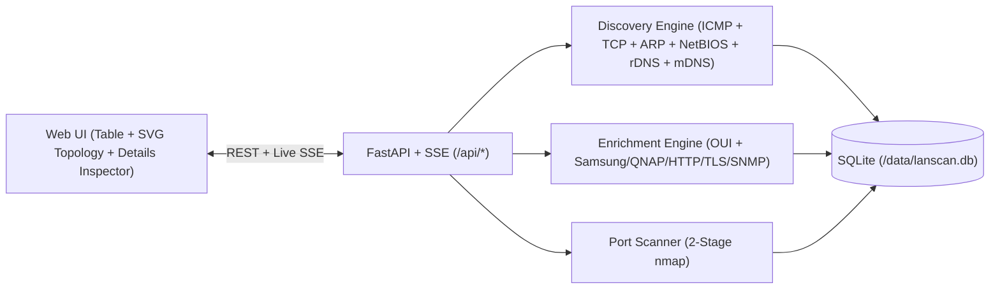

# LanScan Web — Multi-Subnet Network Scanner, Topology Diagram & Port Scanner

**English** | [Español](./README.es.md)


A native desktop (**macOS / iMac** & **Windows**) and self-hosted **Docker** application inspired by **LanScan**, built to discover, inventory, visualize, and audit devices across home or office networks — including **multi-subnet setups and cascaded routers** (e.g., `192.168.1.0/24` + `192.168.2.0/24`) — with zero paywalls or cloud dependencies.

---

## Key Features

- **Multi-Subnet & Cascaded Router Support:**
  - Define and manage multiple subnets/CIDRs with custom names and color tags from the **Config** modal.
  - Scan all enabled networks in one click or target a single subnet.
  - Persistent SQLite history keeps devices from every subnet visible in one unified view with live status indicators (green = online, red = offline).
- **Full Data Table & Inspector Panel (`Details`):**
  - Sortable, searchable columns: `IPv4`, `MAC`, `Hostname`, `Ping`, `Vendor`, `Identification`, `DNS Name`, `mDNS Name`, `SMB Name`, `SMB Domain`, `Ports`, and `Network`.
  - **Complete Device Editing:** customize and persist hostname, locked device category, vendor, model/identification, physical location, admin URL, local access credentials, and notes.
- **Interactive Illustrated SVG Network Topology Diagram:**
  - Visualizes **Internet / WAN → Routers / Gateways → Subnets → Connected Devices** with detailed multi-tone vector device drawings (Router, 4-bay NAS, Smart TV, IP Camera, Printer, Console, IoT Smart Bulb, Streaming Stick, Laptop, Smartphone).
  - Automatic detection of **cascaded routers** via WAN/LAN MAC matching.
  - Pan, zoom (mouse wheel & buttons), fit-to-screen, subnet/search filtering, and click-to-inspect any node.
- **Automated Network Architecture Audit & Recommendations:**
  - Computes a live **Network Health Score (0–100)** across **Topology**, **Security**, **Performance**, and **Organization**.
  - Automatically detects **Double NAT / fragmented subnets**, **multi-homed NAS devices**, **unsegmented IoT & cameras**, **insecure open ports** (FTP, Telnet, RTSP, exposed DBs, HTTP admin), and generates a tailored **DHCP IP Reservation Plan**.
- **Brand & Protocol Enrichment Engine:**
  - Local IEEE OUI database (`nmap-mac-prefixes`) + automatic online OUI lookup fallback cached in SQLite (`maclookup.app`).
  - Active protocol fingerprinting: **Samsung SmartTV API** (`:8001` with screen size, series, and Tizen parsing), **QNAP QTS** metadata, HTTP headers/titles/realms, **TLS** certificates, and **SNMP `sysDescr`** (`UDP 161`).
  - **Router Access & Password Card:** displays locally saved credentials (masked by default with show/hide & copy actions) and provides a factory-default reference for routers when no custom password is saved yet.
- **Two-Stage TCP Port Scanner (`nmap`):**
  - **Quick** (common + NAS/TV/Docker ports), **Top 1000**, **Full (`1–65535`)**, and **Custom** port ranges.
  - Service/version detection, clickable `Open` links for HTTP/HTTPS web interfaces, and basic security alerts (FTP, Telnet, RTSP, etc.).
- **Modern Bilingual Accessible UI (`EN | ES`):**
  - Native **English (default)** and **Spanish** interface switcher (`EN | ES`) in the toolbar and Config dialog, including localized audit recommendations.
  - Automatic **Light / Dark / System** theme (`light-dark()`), responsive layout, and **CSV export** (excluding passwords).

---

## Architecture



---

## Native Desktop Apps (macOS / iMac & Windows — Recommended)

Run **LanScan Web** directly on your Mac or PC without Docker or external tools (`nmap` / `nmblookup` are **not** required). Native desktop builds read your OS Layer-2 ARP table directly for instant **MAC addresses, IEEE OUI vendors (46,000+ bundled offline), and Bonjour/mDNS hostnames**.

### Download Pre-Built Releases

Grab the latest installer from [**GitHub Releases**](https://github.com/jzaldumbide/lanscan-web/releases):

- **macOS (Apple Silicon — M1/M2/M3/M4 iMac & MacBook):** `LanScan-Web-macOS-arm64.dmg`
- **macOS (Intel iMac & MacBook):** `LanScan-Web-macOS-x64.dmg`
- **Windows 10 / 11 (64-bit):** `LanScan-Web-Windows-x64.exe` (or `.zip`)

> **First-launch note (unsigned community builds):**
> - **macOS:** Right-click `LanScan Web.app` → **Open** the first time to allow it past Gatekeeper, and approve the **Local Network** permission prompt so it can scan your LAN.
> - **Windows:** Click **More info → Run anyway** on Windows SmartScreen, and allow Private Network access if Windows Firewall prompts.
> - **Local SQLite database path:** `~/Library/Application Support/LanScanWeb/lanscan.db` (macOS) · `%APPDATA%\LanScanWeb\lanscan.db` (Windows).

### Run or Build Locally from Source

```bash
python3 -m venv .venv
source .venv/bin/activate      # Windows: .venv\Scripts\activate
pip install -r requirements-desktop.txt

# Run natively in a desktop window
python desktop.py

# Or package a local .dmg (macOS) / .exe + .zip (Windows)
python build_desktop.py
```

### Automated Releases via GitHub Actions

Pushing a semantic version tag automatically builds macOS (`arm64` + Intel `x64`) and Windows (`x64`) bundles and publishes them to GitHub Releases:

```bash
git tag v1.0.0
git push origin v1.0.0
```

---

## Quick Start with Docker

### 1. Clone the repository

```bash
git clone https://github.com/jzaldumbide/lanscan-web.git
cd lanscan-web
```

### 2. (Optional) Configure initial subnets

```bash
cp .env.example .env
# Edit .env to customize default subnets before first launch
```

### 3. Build and start

```bash
docker compose up -d --build
```

Open in your browser: **http://localhost:8787**

---

## macOS (Docker Desktop) vs Linux / NAS

### macOS (Docker Desktop)
Docker Desktop runs containers inside a Linux VM behind NAT. Multi-subnet discovery, port scanning, NetBIOS/SMB, HTTP, TLS, and protocol probing work directly across all subnets reachable from your Mac, but Layer-2 ARP MAC addresses on your physical Wi-Fi interface are not directly exposed to the VM.

To enrich **MAC addresses and IEEE OUI vendors** from your Mac's native ARP table, run the included helper script:

```bash
# One-time sync
./scripts/macos-arp-sync.sh

# Or continuous sync every 30 seconds
./scripts/macos-arp-sync.sh --watch
```

### Linux / QNAP / Synology NAS (Recommended for 24/7 use)
On a Linux host or NAS, edit [docker-compose.yml](./docker-compose.yml), uncomment `network_mode: host` (and comment out `ports:`):

```yaml
services:
  lanscan-web:
    build: .
    container_name: lanscan-web
    restart: unless-stopped
    network_mode: host
    cap_add:
      - NET_RAW
      - NET_ADMIN
```

With `network_mode: host`, the container gains **native Layer-2 ARP, SSDP, and mDNS discovery** with no external helper scripts needed.

---

## REST API Reference

| Method | Endpoint | Description |
| :--- | :--- | :--- |
| `GET` | `/api/bootstrap` | Initial state (subnets, devices, scan status, settings) |
| `POST` | `/api/scan/start` | Start scanning all enabled subnets or specific `subnet_ids` |
| `POST` | `/api/scan/stop` | Stop an active scan |
| `GET` | `/api/topology` | Return multi-subnet graph with gateways, cascaded links, and devices |
| `GET` | `/api/recommendations` | Run automated network architecture & security audit with Health Score |
| `PATCH` | `/api/devices/{ipv4}` | Save edited device details (hostname, type, location, credentials, notes) |
| `POST` | `/api/devices/{ipv4}/port-scan` | Run TCP port scan (`quick`, `common`, `full`, `custom`) |
| `POST` | `/api/devices/{ipv4}/enrich` | Run deep enrichment (protocols, TLS, SNMP, online OUI lookup) |
| `POST` | `/api/enrich-all` | Enrich all known devices |
| `POST` | `/api/arp-sync` | Ingest external ARP entries (used by `macos-arp-sync.sh`) |
| `GET` | `/api/export.csv` | Export device inventory as CSV (passwords excluded) |
| `GET` | `/api/events` | Server-Sent Events (SSE) stream for live UI updates |

---

## Security & Privacy

- **Never commit `data/` or `.env`:** both are excluded via `.gitignore` to keep your SQLite database, internal IPs, and saved credentials strictly local.
- **Router passwords:** no legitimate network scanner can read a router's configured password over the network. LanScan Web lets you **store your own credentials locally** in your private SQLite database (masked by default) and displays **public factory-default references** only as a diagnostic aid when no password has been saved yet.
- **Responsible use:** intended strictly for managing and auditing networks you own or are authorized to test.

---

## Project Structure

```text
lanscan-web/
├── .github/workflows/
│   └── release.yml         # Automated macOS (arm64/x64) & Windows (x64) releases
├── desktop.py              # Native desktop launcher (FastAPI + pywebview)
├── build_desktop.py        # PyInstaller packager (.dmg / .exe / .zip)
├── requirements-desktop.txt
├── Dockerfile
├── docker-compose.yml
├── requirements.txt
├── .env.example
├── .gitignore
├── LICENSE
├── README.md               # English documentation
├── README.es.md            # Documentación en español
├── scripts/
│   └── macos-arp-sync.sh
└── app/
    ├── main.py             # FastAPI REST API + SSE + static assets
    ├── db.py               # Cross-platform SQLite persistence
    ├── scanner.py          # Multi-subnet discovery, pure-Python & nmap port scanner
    ├── enrichment.py       # Brand intelligence, TLS, SNMP, online OUI & topology
    ├── advisor.py          # Automated network architecture & security audit
    ├── data/
    │   └── nmap-mac-prefixes  # Bundled IEEE OUI database (offline vendor lookup)
    └── static/
        ├── index.html      # Web UI (Table, SVG Topology, Audit, Inspector, Modals)
        ├── styles.css      # Native light-dark() & container-query styling
        ├── i18n.js         # English & Spanish UI localization
        └── app.js          # Reactive UI, interactive SVG map & SSE client
```

---

## License

Distributed under the **MIT License**. See [LICENSE](./LICENSE) for details.
