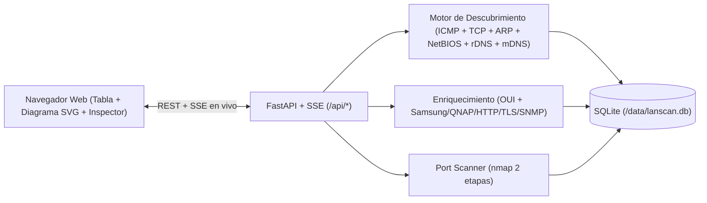

# LanScan Web — Escáner Multi-Red, Topología y Puertos en Docker


Aplicación web self-hosted inspirada en **LanScan**, diseñada para descubrir, inventariar, visualizar y auditar todos los equipos de tu red doméstica o de oficina — incluyendo hogares con **múltiples subredes y routers en cascada** (por ejemplo `192.168.1.0/24` + `192.168.2.0/24`), sin límites de pago ni dependencias en la nube.

---

## Características principales

- **Soporte Multi-Red y Routers en Cascada:**
  - Configura múltiples subredes/CIDR con nombre y color personalizado desde la interfaz (**Config**).
  - Escanea todas tus redes en un clic o selecciona una subred específica.
  - Conserva el historial persistente en SQLite para ver equipos de todas tus redes en una sola vista con estado en vivo (verde = activo, rojo = inactivo).
- **Tabla completa + Panel Inspector (`Details`):**
  - Columnas ordenables y búsqueda instantánea: `IPv4`, `MAC`, `Hostname`, `Ping`, `Vendor`, `Identification`, `DNS Name`, `mDNS Name`, `SMB Name`, `SMB Domain`, `Ports` y `Red`.
  - **Edición completa de detalles:** edita y guarda en SQLite el hostname personalizado, categoría del equipo (bloqueable para no ser sobrescrita), marca, modelo/identificación, ubicación física, URL de administración, usuario/contraseña de acceso y comentarios.
- **Diagrama de Red Interactivo:**
  - Vista topológica en SVG con **Internet / WAN → Routers/Gateways → Subredes → Equipos** con íconos vectoriales por categoría (Router, NAS, Smart TV, Cámara/DVR, Impresora, Consola, IoT, Streaming, PC/Móvil).
  - Detección automática de **routers en cascada** por coincidencia de MAC WAN/LAN.
  - Zoom con rueda/botones, arrastre (pan), ajuste automático y clic en cualquier nodo para inspeccionar su ficha y puertos.
- **Motor de Enriquecimiento por Marca y Protocolos:**
  - Base local IEEE OUI (`nmap-mac-prefixes`) + consulta online automática con caché en SQLite (`maclookup.app`).
  - Sondeo activo de protocolos: API de **Samsung SmartTV** (`:8001` con decodificación de pulgadas, serie y Tizen), metadata de **QNAP QTS**, banners/títulos/realms HTTP, certificados **TLS** y **SNMP `sysDescr`** (`UDP 161`).
  - **Referencia de acceso para Routers:** muestra la tarjeta de credenciales locales guardadas (con botón mostrar/ocultar y copiar) y, si es un router sin contraseña guardada, ofrece una referencia de credenciales de fábrica conocidas (con recomendación de seguridad).
- **Escáner de Puertos TCP (`nmap` en 2 etapas):**
  - Modos **Rápido** (puertos comunes + NAS/TV/Docker), **Top 1000**, **Completo (`1-65535`)** y **Personalizado**.
  - Detección de servicio/versión, enlaces rápidos `Abrir` para paneles HTTP/HTTPS y alertas de seguridad (FTP, Telnet, RTSP, etc.).
- **UI moderna y accesible:**
  - Tema **Claro / Oscuro / Sistema** automático (`light-dark()`), diseño responsivo y exportación a **CSV** (excluyendo contraseñas).

---

## Arquitectura



---

## Inicio rápido con Docker

### 1. Clonar el repositorio

```bash
git clone https://github.com/jzaldumbide/lanscan-web.git
cd lanscan-web
```

### 2. (Opcional) Personalizar tus subredes iniciales

```bash
cp .env.example .env
# Edita .env si quieres definir tus subredes por defecto antes del primer arranque
```

### 3. Construir y levantar el contenedor

```bash
docker compose up -d --build
```

Abre en tu navegador: **http://localhost:8787**

---

## Uso en macOS (Docker Desktop) vs Linux / NAS

### macOS (Docker Desktop)
Docker Desktop ejecuta los contenedores dentro de una máquina virtual Linux con NAT. El descubrimiento de equipos, puertos, NetBIOS/SMB, HTTP, TLS y protocolos funciona directamente a través de todas las subredes alcanzables desde tu Mac, pero la tabla ARP capa 2 física del Wi-Fi no es visible desde dentro de la VM.

Para enriquecer al instante las **direcciones MAC y fabricantes (OUI)** de tu red activa en macOS, incluye este script auxiliar:

```bash
# Sincronización puntual
./scripts/macos-arp-sync.sh

# O sincronización continua cada 30 segundos
./scripts/macos-arp-sync.sh --watch
```

### Linux / QNAP / Synology NAS (Recomendado para operación 24/7)
En un host Linux o NAS, edita [docker-compose.yml](./docker-compose.yml), descomenta `network_mode: host` (y comenta la sección `ports:`):

```yaml
services:
  lanscan-web:
    build: .
    container_name: lanscan-web
    restart: unless-stopped
    network_mode: host
    cap_add:
      - NET_RAW
      - NET_ADMIN
```

En modo `host`, el contenedor obtiene **ARP capa 2, SSDP y mDNS de forma 100% nativa** sin necesidad de scripts externos.

---

## API REST principal

| Método | Endpoint | Descripción |
| :--- | :--- | :--- |
| `GET` | `/api/bootstrap` | Estado inicial completo (subredes, equipos, estado de escaneo y ajustes) |
| `POST` | `/api/scan/start` | Inicia escaneo en todas las subredes activas o las indicadas en `subnet_ids` |
| `POST` | `/api/scan/stop` | Detiene el escaneo en curso |
| `GET` | `/api/topology` | Devuelve el grafo de subredes, gateways, cascadas y dispositivos |
| `PATCH` | `/api/devices/{ipv4}` | Guarda detalles editados (hostname, categoría, ubicación, credenciales, notas) |
| `POST` | `/api/devices/{ipv4}/port-scan` | Ejecuta escaneo de puertos (`quick`, `common`, `full`, `custom`) |
| `POST` | `/api/devices/{ipv4}/enrich` | Ejecuta enriquecimiento profundo (protocolos, TLS, SNMP, OUI online) |
| `POST` | `/api/enrich-all` | Enriquece todos los equipos registrados |
| `POST` | `/api/arp-sync` | Recibe entradas ARP externas (usado por `macos-arp-sync.sh`) |
| `GET` | `/api/export.csv` | Exporta el inventario a CSV (sin contraseñas) |
| `GET` | `/api/events` | Stream Server-Sent Events (SSE) con actualizaciones en tiempo real |

---

## Seguridad y privacidad

- **Nunca publiques tu carpeta `data/` ni `.env`:** ambos están excluidos en `.gitignore` para evitar filtrar tu base de datos SQLite, direcciones IP internas o credenciales guardadas.
- **Contraseñas de routers:** ningún escáner de red legítimo puede leer la contraseña real configurada en un router de forma remota. LanScan Web te permite **guardar tus propias credenciales localmente** en tu base SQLite privada (ocultas por defecto en pantalla) y muestra únicamente **referencias de fábrica conocidas** como ayuda diagnóstica cuando un router aún no tiene clave registrada.
- **Uso responsable:** esta herramienta está pensada exclusivamente para administrar y auditar redes propias o autorizadas.

---

## Estructura del proyecto

```text
lanscan-web/
├── Dockerfile
├── docker-compose.yml
├── requirements.txt
├── .env.example
├── .gitignore
├── LICENSE
├── README.md
├── scripts/
│   └── macos-arp-sync.sh
└── app/
    ├── main.py          # API FastAPI + SSE + estáticos
    ├── db.py            # Persistencia SQLite (subredes, equipos, caché OUI)
    ├── scanner.py       # Motor de descubrimiento multi-red y escáner nmap
    ├── enrichment.py    # Inteligencia por marca, TLS, SNMP, OUI online y topología
    └── static/
        ├── index.html   # Interfaz web (Tabla, Diagrama SVG, Inspector, Modales)
        ├── styles.css   # Estilos nativos con light-dark() y container queries
        └── app.js       # Lógica reactiva, diagrama interactivo y SSE
```

---

## Licencia

Distribuido bajo licencia **MIT**. Consulta [LICENSE](./LICENSE) para más detalles.
